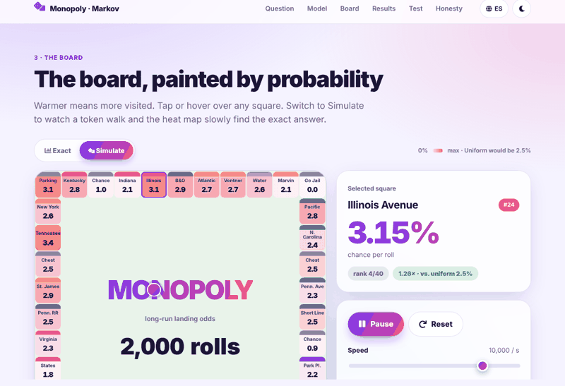
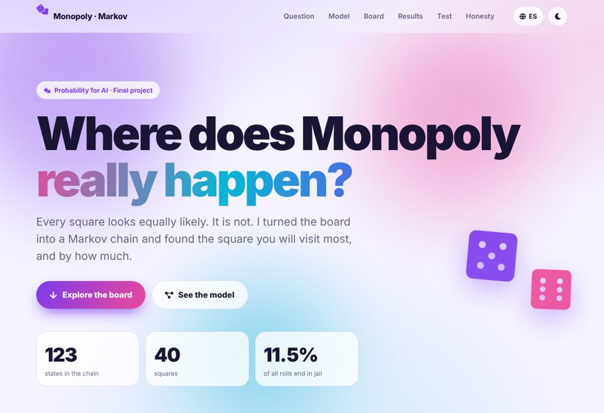
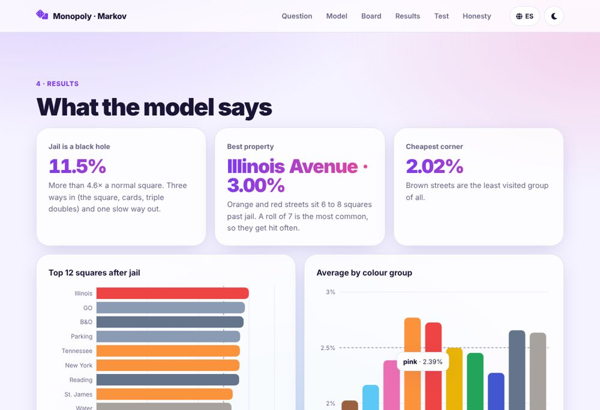
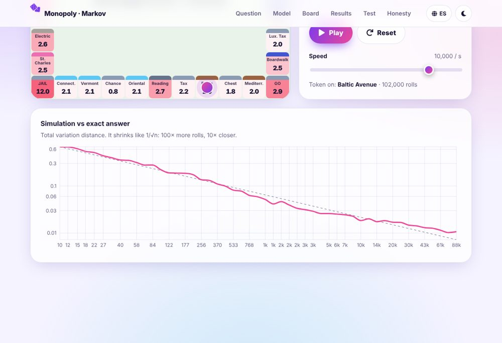
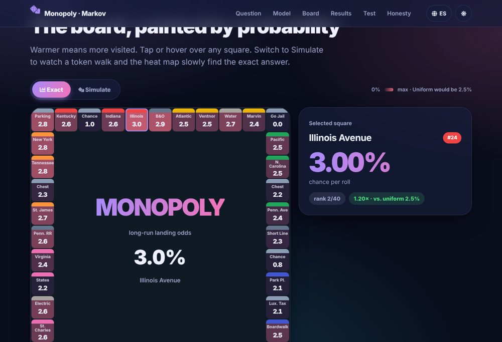

<div align="center">

# 🎲 Where does Monopoly *really* happen?
### ¿Dónde pasa *de verdad* el Monopoly?

**Monopoly as a Markov chain · Monopoly como cadena de Markov**

[](https://monopoly-markov.netlify.app/)
[](https://react.dev)
[](https://www.typescriptlang.org)
[](https://web.stanford.edu)

<br/>



<sub>A token walks the board and the heat map slowly finds the exact answer · La ficha camina y el mapa de calor encuentra poco a poco la respuesta exacta</sub>

<br/>

**🇬🇧 [English](#-english) · 🇨🇴 [Español](#-español)**

</div>

---

<a id="-english"></a>
# 🇬🇧 English

## ✨ What is this?

Every square on a Monopoly board *looks* equally likely. **It is not.**
This project turns the board into a **Markov chain** (123 states, two dice, Chance and Community Chest cards, jail, three doubles in a row) and answers one question:

> **In the long run, what share of all dice rolls ends on each of the 40 squares?**

It was built as the final project for **Probability for AI** (Stanford).

🔗 **Try it live: [monopoly-markov.netlify.app](https://monopoly-markov.netlify.app/)**

<div align="center">

</div>

## 🏆 Main findings

| 🎯 | Finding |
|---|---|
| 🔒 **Jail** | **11.5%** of all rolls, about **4.6×** a normal square (2.5% would be uniform) |
| 🥇 **Best property** | **Illinois Avenue**, 3.00% |
| 🟠🔴 **Best groups** | Orange (2.77%) and red (2.73%) on average |
| 🟤 **Cheapest corner** | Brown streets, 2.03% on average |
| 🃏 **Deck memory?** | Barely matters: the realistic game differs from the model about as much as pure sampling noise |

<div align="center">

</div>

## 🧠 The model in one minute

1. 🎲 **Roll two dice.** Each of the 36 outcomes has probability 1/36.
2. 🚶 **Move and resolve.** *Go To Jail*, Chance and Community Chest can move you again.
3. 🔁 **Doubles.** A double gives another roll; the **third** in a row sends you to jail.
4. 🔒 **Jail.** Try to roll a double up to 3 times, then pay and leave.

The state is *(square, doubles in a row)* plus three jail states. The long-run distribution solves

```
π = π P
```

and is found by power iteration (it converges in 255 steps). There are **no fitted parameters**: every probability comes from the dice or the card counts.

## 🧪 How it was tested

| Check | Result |
|---|---|
| **Sanity** | With every special rule off, every square is exactly 2.5% ✅ |
| **Simulation** | A walker following the chain gets within total-variation distance 0.00076 after 10⁷ rolls, shrinking like 1/√n ✅ |
| **Held-out test** | A separate game with real shuffled decks, run once on a fixed seed (2,000,000 rolls): distance 0.00172 vs 0.00153 for pure noise ✅ |

<div align="center">

</div>

## 🎛️ Features

- 🔥 Interactive **heat-map board**: hover or tap any square
- ▶️ **Live simulation** with adjustable speed and a convergence chart
- 🎚️ **Rule toggles**: Go To Jail, cards, triple doubles, pay out of jail
- 🧾 **"What if…?"** table that recomputes the exact answer for 6 rule sets
- 🧪 In-browser **held-out test**
- 🌍 **English / Español** switch
- 🌗 **Light / dark** mode
- 📱 Fully **responsive**, with smooth animations
- 🔌 Runs **100% in your browser**, no network needed

<div align="center">

</div>

## 🚀 Run it locally

```bash
git clone https://github.com/DanielaM1293/Monopoly-Markov.git
cd Monopoly-Markov
npm install
npm run dev        # development server
npm run build      # production build in dist/
npm test           # check the engine against simulations
```

## 🗂️ Project structure

```
src/
├── engine.ts   # Markov chain, stationary distribution, simulations
├── data.ts     # the 40 squares, colours and board layout
├── i18n.ts     # English and Spanish text
├── ui.ts       # styled-components design system (light/dark)
├── App.tsx     # the whole interface
└── main.tsx    # entry point
scripts/        # validation and tooling
```

## ⚠️ Limits

- The token's position is counted after **every roll**, not once per turn.
- Cards are modelled as independent draws; *Get out of jail free* is treated as a stay-in-place card.
- Free Parking has no house rule, and the cards are from the classic US edition.
- The model says **nothing about who wins**: money, buying and building are not modelled.

## 🤖 AI use

I used **Claude** (Anthropic) to write the code and to explain how to set up the chain. The question, my guesses, the choice of rules and the interpretation are my own work.

---

<a id="-español"></a>
# 🇨🇴 Español

## ✨ ¿Qué es esto?

Todas las casillas del Monopoly *parecen* igual de probables. **No lo son.**
Este proyecto convierte el tablero en una **cadena de Markov** (123 estados, dos dados, cartas de Suerte y Arca Comunal, cárcel y tres dobles seguidos) y responde una pregunta:

> **A largo plazo, ¿qué porcentaje de todas las tiradas termina en cada una de las 40 casillas?**

Es el proyecto final del curso **Probability for AI** (Stanford).

🔗 **Pruébalo en vivo: [monopoly-markov.netlify.app](https://monopoly-markov.netlify.app/)**

## 🏆 Resultados principales

| 🎯 | Hallazgo |
|---|---|
| 🔒 **Cárcel** | **11.5%** de las tiradas, unas **4.6×** una casilla normal (uniforme sería 2.5%) |
| 🥇 **Mejor propiedad** | **Illinois Avenue**, 3.00% |
| 🟠🔴 **Mejores grupos** | Naranja (2.77%) y rojo (2.73%) en promedio |
| 🟤 **La esquina más barata** | Calles marrón, 2.03% en promedio |
| 🃏 **¿Memoria del mazo?** | Casi no importa: el juego realista difiere del modelo tanto como el simple ruido de muestreo |

## 🧠 El modelo en un minuto

1. 🎲 **Tira dos dados.** Cada uno de los 36 resultados tiene probabilidad 1/36.
2. 🚶 **Avanza y resuelve.** *Ve a la cárcel*, Suerte y Arca Comunal pueden moverte otra vez.
3. 🔁 **Dobles.** Un doble da otra tirada; el **tercero** seguido te manda a la cárcel.
4. 🔒 **Cárcel.** Intentas sacar un doble hasta 3 veces, luego pagas y sales.

El estado es *(casilla, dobles seguidos)* más tres estados de cárcel. La distribución a largo plazo resuelve

```
π = π P
```

y se encuentra por iteración de potencias (converge en 255 pasos). **No hay parámetros ajustados**: cada probabilidad viene de los dados o del conteo de cartas.

## 🧪 Cómo se probó

| Verificación | Resultado |
|---|---|
| **Sanidad** | Con todas las reglas especiales apagadas, cada casilla es exactamente 2.5% ✅ |
| **Simulación** | Un caminante que sigue la cadena queda a distancia de variación total 0.00076 tras 10⁷ tiradas, bajando como 1/√n ✅ |
| **Prueba reservada** | Un juego aparte con mazos barajados de verdad, corrido una vez con semilla fija (2,000,000 tiradas): distancia 0.00172 frente a 0.00153 de puro ruido ✅ |

## 🎛️ Características

- 🔥 **Tablero con mapa de calor** interactivo: pasa el cursor o toca cualquier casilla
- ▶️ **Simulación en vivo** con velocidad ajustable y gráfico de convergencia
- 🎚️ **Interruptores de reglas**: Ve a la cárcel, cartas, tres dobles, pagar para salir
- 🧾 Tabla **"¿Y si…?"** que recalcula la respuesta exacta para 6 conjuntos de reglas
- 🧪 **Prueba reservada** dentro del navegador
- 🌍 Selector **English / Español**
- 🌗 Modo **claro / oscuro**
- 📱 Totalmente **responsive**, con animaciones suaves
- 🔌 Corre **100% en tu navegador**, sin red

## 🚀 Ejecútalo en tu computador

```bash
git clone https://github.com/DanielaM1293/Monopoly-Markov.git
cd Monopoly-Markov
npm install
npm run dev        # servidor de desarrollo
npm run build      # compilación de producción en dist/
npm test           # compara el motor con simulaciones
```

## 🗂️ Estructura

```
src/
├── engine.ts   # cadena de Markov, distribución estacionaria, simulaciones
├── data.ts     # las 40 casillas, colores y disposición del tablero
├── i18n.ts     # textos en inglés y español
├── ui.ts       # sistema de diseño con styled-components (claro/oscuro)
├── App.tsx     # toda la interfaz
└── main.tsx    # punto de entrada
scripts/        # validación y herramientas
```

## ⚠️ Límites

- La posición de la ficha se cuenta después de **cada tirada**, no una vez por turno.
- Las cartas se modelan como sacadas independientes; *Sal gratis de la cárcel* se trata como una carta que no mueve.
- Parqueo libre no tiene regla especial y las cartas son de la edición clásica de EE. UU.
- El modelo **no dice nada sobre quién gana**: el dinero, las compras y la construcción no están modelados.

## 🤖 Uso de IA

Usé **Claude** (Anthropic) para escribir el código y para explicar cómo plantear la cadena. La pregunta, mis apuestas, la elección de reglas y la interpretación son trabajo mío.

---

<div align="center">

Made with 💜 for **Probability for AI** · Hecho con 💜 para **Probability for AI**

🎲 *Every roll counts · Cada tirada cuenta* 🎲

</div>
